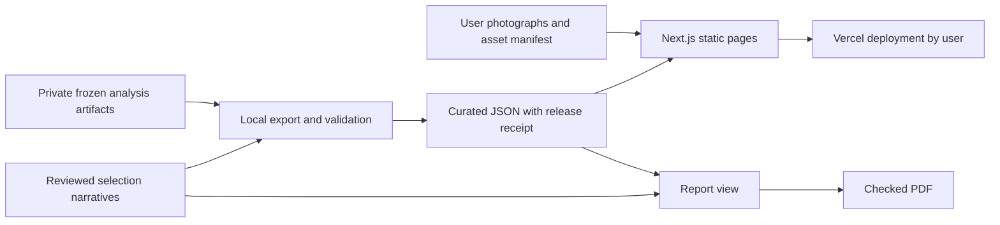

# The Pressure Index — Next.js dashboard implementation plan

Prepared 14 November 2026; implementation authorized 17 November; implemented and locally verified 18 November. **Status: dashboard, twenty supplied portraits and PDF companion implemented; user deployment and nineteen authenticated name labels pending.** Read-only export, Next.js routes/components, comparisons, method/validation pages and the report view are implemented. Clean standalone install/build, numerical publication checks, browser/accessibility checks and measured loading audits are recorded in [progress.md](progress.md). Selected-player portraits use individually reviewed crops; alternatives without images retain placeholders. This promotes the presentation dashboard from its earlier deferred status without reopening the frozen analytical method. Deployment instructions are in [dashboard/DEPLOYMENT.md](dashboard/DEPLOYMENT.md).

## 1. Product decision and submission contract

The cricket question is: **who would we recommend for each pressure task, and what evidence makes that recommendation defensible?** The interface should let a judge find the two lists immediately, understand one selection in a minute, and inspect the complete method when desired.

The website and required PDF will tell the same story, using the same exported numbers and approved editorial content. The Unstop form still requires twenty player selections and a PDF/PPTX file; the dashboard URL is an optional additional field. Build the website as the principal interactive presentation and generate its companion PDF from a dedicated report view. See [verified submission rules](SUBMISSION_FORMAT.md).

Completion means:

- Two clearly ordered top-ten lists, matching the frozen CSV and methodology exactly.
- Twenty complete selected-player profiles, each with role, rationale, uncertainty, repeatability, counterexamples and alternatives.
- Understandable pressure/rating explanations, with enough technical detail to reproduce the analysis.
- Visible qualifications about coverage, ordinary comparisons, recent evidence and close boundaries.
- A fast, accessible mobile/desktop site that can deploy from GitHub to Vercel without access to the private Python workspace.
- A checked PDF below the 50 MB upload limit, the final production URL, and a reconciled dropdown checklist.

The current evidence supports 75 batting / 104 bowling rankable entries. The public presentation will focus on the selected twenty and their existing alternatives. Existing alternative registers contain 49 distinct alternative player-role entries, giving **69 selected-or-alternative entries**. This bounds the presentation without introducing a new shortlist or recomputing rankings.

## 2. Visual direction

Working title: **THE PRESSURE INDEX**. Descriptor: *An independent SupeRR Selector submission*. The visual language combines an editorial sports cover with a precise analytical report.

### Design system

| Element | Concrete direction |
| --- | --- |
| Main canvas | White `#FFFFFF`, dark navy text `#152238`, blush panels `#FFF6FA`, pale pink highlights `#FFF0F6` and subtle pink-grey borders `#EAD9E2`. User-requested RR pink amendment, 18 November 2026. The printable report retains warm ivory `#F6F3EE`. |
| Accent | Readable pink `#BB1D64` for text/buttons, brighter `#E63B87` for the header rule and checkbox accent, and soft pink card borders `#F3C1D6`. Muted gold `#8A651F` where needed. Check every foreground/background pairing for contrast. |
| Typography | Condensed display type for large headlines/rank numerals; a readable sans-serif for explanations; tabular numerals for statistics. Self-host licensed font files using `next/font/local`; provide system fallbacks. |
| Composition | Large player portraits, oversized rank numbers, asymmetric hero composition, thin scoreboard-like rules, generous whitespace and aligned numeric columns. |
| Data colours | Consistent role-specific series; label and pattern differences accompany colour. Amber means limited evidence, never automatically poor performance. |
| Motion | Short 160–240 ms transitions, one restrained hero entrance, gentle image hover on pointer devices. Honour reduced motion; use CSS transform/opacity. |
| Surface detail | Flat white and blush surfaces with thin borders and minimal shadows. No coloured glows or gradient panels. Reading surfaces stay plain and high contrast. |

The dramatic element is photography, typography and composition. The page must remain easy to scan. Avoid continuous animation, autoplay video, scroll locking, custom cursors, heavy WebGL scenes and an endless carousel. They add loading and interaction costs without explaining a selection.

### Opening viewport

```text
THE PRESSURE INDEX     Rankings  Compare  Method  Validation     Report
─────────────────────────────────────────────────────────────────────
10 BATTERS.                         Three-player portrait composition
10 BOWLERS.                         with editorial rank typography
THE EVIDENCE BEHIND EVERY PICK.

[ Explore the selections ]  [ How we rated pressure ]

2023–1 Nov 2026     511 verified matches     Retrospective analysis
─────────────────────────────────────────────────────────────────────
Batting / Bowling switch       Ranking preview + interval explanation
```

The overview should disclose the scope immediately. It must not resemble a live scoreboard, claim official RR ownership, or imply that the rankings predict IPL 2027 performance.

## 3. Pages and navigation

| Route | Purpose | Main content and interactions |
| --- | --- | --- |
| `/` | Fast editorial overview | Portrait hero, links to both top tens, scope, three-step method summary, selected evidence and limitations, report download. |
| `/rankings/batting` and `/rankings/bowling` | Answer “who and in what order?” | A compact rank-one card beside the top-aligned desktop heading, with player details to the right of the portrait; nine cards in a 3×3 desktop/tablet grid. Tablet headers and phone cards stack responsively. Shared filters/comparison controls and a compact table view retain all ten original ranks. Pressure exposure, intervals, evidence tags and boundary alternatives remain available. |
| `/players/[role]/[playerId]` | Explain one recommendation | Full selected-player dossier; a compact comparison-candidate variant for the 49 alternatives. Stable-ID routes prevent alias collisions. |
| `/compare?role=batting&players=...` | Inspect a close decision | Two or three players from the same role, aligned metrics, intervals, phase mix, recent evidence, weaknesses and the reason for the frozen ordering. |
| `/methodology` | Explain the complete approach | Pressure definition, reconciliation, opportunity definitions, peers, scaling/shrinkage, bootstrap/order, usual-performance limitations and registered sensitivities. |
| `/validation` | Show how much to trust it | Source attrition, development versus reserved versus final windows, weight stability, match/season influence, recent-evidence qualifications and failed predictive-model history. |
| `/report` | Standalone submission document | Print layout containing both lists, concise selection arguments, method, diagnostics and limitations; generated PDF download after validation. |

Desktop navigation is a small sticky top bar, not a large admin sidebar. Mobile uses a compact menu and visible role switch; comparison actions remain usable with touch and keyboard. Every profile supports a direct URL and browser back navigation.

Three reading depths:

1. **30 seconds:** final lists and what the analysis measures.
2. **3 minutes:** chosen player's rationale, strongest challenge and close alternative.
3. **10 minutes:** full method, reliability and downloadable report.

## 4. Rankings and player evidence

### Ranking cards

Each card displays portrait, actual rank, name, observed role summary, ranking statistic, interval, pressure matches/opportunities and a link to evidence. Show native score units; do not invent a 0–100 score, win probability, star rating or unsupported confidence percentage. Display score values to four decimal places, retain full precision in the data, and explain that displayed ties can arise through rounding.

Search and evidence/role filters narrow the visible cards while retaining original ranks. A filtered fifth-ranked player stays ranked fifth. The role switch selects a different list; it does not make batting and bowling scores directly comparable.

### Selected-player page, in order

1. **Portrait and decision:** rank, name, observed role, one clear selection argument and the strongest qualification beside it.
2. **What task the player has performed:** total phase workload and pressure-only phase workload shown separately. Use “observed late-over workload,” for example, unless a more specific role is supported.
3. **Performance under pressure:** runs and dismissals for batting; conceded runs and wickets for bowling; denominators, interval and comparison with retained peers.
4. **Repeatability:** season exposure/performance, family diagnostics, one-match and one-season deletion sensitivity. Point sensitivities are labelled separately from bootstrap intervals.
5. **Supporting case and counterexample:** the same frozen case-selection protocol, with opponent/date, aggregate pressure contribution, context, both outcomes and a plain-language interpretation. Keep a typical case available as well.
6. **Usual-performance comparison:** all-ordinary background versus supported comparisons; support coverage and reliability state. Missing or unreliable change displays an explanation rather than zero or an improvement arrow.
7. **Why this player over alternatives:** boundary and role-similar candidates from the saved register, with aligned evidence and explicit overlap/uncertainty.
8. **Potential cricket contribution:** describe the task the evidence supports and its limitations. Avoid asserting current availability, a squad vacancy, price or future transfer performance.
9. **Evidence details:** definitions, sample/coverage checks, analytical release ID, and source attribution at the appropriate aggregate level.

The 49 alternative profiles reuse the factual components with a “Comparison candidate” heading. They do not require 49 new photographs or newly invented selector essays. Full editorial attention goes to the selected twenty and close boundaries.

### Charts and their meanings

| Chart | Data and safeguards |
| --- | --- |
| Ranking interval plot | Frozen point, 10th and 90th percentiles; rank uses the 10th percentile. Explain this is a conditional sampling interval, not a probability of being top ten. |
| Phase workload bars | Separate all-opportunity and pressure-opportunity shares with explicit denominators. |
| Season evidence | Display opportunities/matches alongside observed rates. Missing seasons are gaps, not zero performance. |
| IPL/T20I comparison | Family-specific diagnostics with uncertainty/support. Do not imply equal competition strength or guaranteed IPL transfer. |
| Deletion sensitivity | Point changes after removing a match/season; inadequate remaining samples get an unavailable state. |
| Weight sensitivity | Show only the pre-registered 60/40, 50/50 and 70/30 runs/wickets variants. Clearly distinguish them from the unavailable level/change companions. |

Use simple React/SVG charts with visible axes, accessible descriptions and an equivalent table. These few chart types do not need a large charting framework. Keep formatting, metric direction, missing-state and scale logic in shared utilities with meaningful checks.

## 5. Methodology and reliability storytelling

Explain the actual work in this order:

1. Supplied data and scoring ambiguity; why original extras could not be assumed to equal one run.
2. Reconciliation, trustworthy pre-ball state and retained/excluded evidence. Note that the later official archive's extras agree with the retained final verified ledger; the frozen source was preserved.
3. Frozen pressure rule: late OR collapse OR tight chase. Explain the observed roughly 35% share and why thresholds were not tuned to particular players.
4. Task-specific run/wicket outcomes and analytical opportunity definitions.
5. Leave-player-out pressure peers in the same broad contexts, development-only scales, 730-day recency and shrinkage.
6. Whole-match uncertainty and conservative ordering; fixed eligibility/support.
7. Supported usual-performance comparisons and why ordinary death-over controls are unavailable.
8. Separate reserved-2026 evaluation, combined final evidence and fixed sensitivity checks.

The ML history appears as a concise expandable timeline: predictive baselines were actually fitted, their calibration gates failed, and the approved final estimator is descriptive. Do not label the final dashboard “AI-powered predictions” or imply that a failed model selected the players.

Keep these material qualifications visible near the related claims:

- Only **7/20 selected entries** meet all standalone 2026 rating requirements; two have no retained 2026 pressure observations.
- No reliable supported-change interval is available for final companion ordering.
- Exact boundary ranks have overlapping intervals and weight sensitivity.
- Coverage is uneven; missing evidence is not poor performance.
- The method is retrospective and incompletely adjusts venue, opposition and fine chase difficulty.

A small optional pressure-rule demonstrator may follow the core pages. It uses clearly labelled illustrative situations and frozen conditions, with coherent innings/ball/wicket inputs. It explains which rule fires; it neither estimates win probability nor changes player scores. Cut it first if it threatens completion.

## 6. Application architecture

Use **Next.js App Router + React + strict TypeScript + Tailwind CSS**, with accessible HTML controls and lightweight CSS motion. Pin the current stable compatible package versions and Node LTS in the implementation lockfile/runtime configuration. Official Next.js documentation currently shows v16.4.6 and a minimum Node version of 20.9; verify compatibility when scaffolding rather than guessing dependency combinations.

Pages and layouts use Server Components and build-time data by default. Small Client Components own filters, the compare tray, tabs and chart tooltips. Pre-render the finite player routes with `generateStaticParams`. Render readable rankings and profiles without waiting for browser-side data fetching. The compare query-string controller can live behind a Suspense boundary on a statically rendered page.

Use normal Next.js deployment on Vercel with pre-rendered pages. Do not set `output: 'export'` by default: Vercel's standard Next.js support permits the normal image optimisation path. No database, authentication, Python server, runtime model execution, live cricket API or secret is needed.



### Proposed repository layout

```text
scripts/export_dashboard.py         # New read-only export; outside frozen scoring modules
dashboard/
  app/
    layout.tsx
    page.tsx
    rankings/[role]/page.tsx
    players/[role]/[playerId]/page.tsx
    compare/page.tsx
    methodology/page.tsx
    validation/page.tsx
    report/page.tsx
    not-found.tsx
    globals.css
  components/
    layout/                        # Header, navigation, footer
    players/                       # Portrait, card, dossier and comparison sections
    charts/                        # Interval, phase, season and sensitivity SVGs
    evidence/                      # Cases, sample status, definitions, limitations
    ui/                            # Buttons, tabs, accessible disclosure controls
  content/
    generated/                     # Curated publishable aggregates only
    editorial/                     # Reviewed narrative keyed by role + player ID
    player-assets.json
  lib/                             # Schemas, selectors, formatting and chart scales
  public/players/                   # Optimised portraits supplied by user
  public/reports/                   # Final checked PDF only
  scripts/                         # Content checks and PDF rendering
  tests/                           # Data-contract and browser tests
  package.json
  package-lock.json
  next.config.ts
  tsconfig.json
  DEPLOYMENT.md
```

Put Vercel's project root at `dashboard/`. `npm ci` and the build must work in a clean clone with no `reports/`, `data/`, Python environment or local secrets. Use a root `.vercelignore` where applicable and inspect actual deployment files; Git-ignore alone is not a substitute for checking a CLI upload. The user will deploy the completed app.

## 7. Data export and consistency contract

Never compute or amend analytical scores in the browser. A new read-only Python exporter verifies the frozen protocol and output hashes, then creates an allowlisted presentation bundle. Its source is the existing final evaluation, not a rerun of the estimator.

| Export | Source and purpose |
| --- | --- |
| `release.json` | Cutoff, windows, aggregate counts, method/release identifiers and source artifact hashes; no local filesystem paths. |
| `rankings.json` | Exact twenty rows from `two_top_ten_lists.csv`, original order, IDs and source names; verified display aliases held separately. |
| `players/<role>-<id>.json` | Selected/alternative status, observed phase/task evidence, pressure metrics, uncertainty, coverage, sample checks and available season/family summaries. |
| `cases.json` | Curated nominated case aggregates and reviewed interpretation for selected players; no ball-by-ball export. |
| `alternatives.json` | Existing 119 selected-to-alternative relationships across 49 alternative role entries; no newly optimised alternative selection. |
| `validation.json` | Cohort attrition, registered sensitivity, temporal checks, and honest availability of estimates. |
| `methodology.json` | Frozen explanatory constants/labels, methodology sections and glossary. |

The 69 role entries are generated from the existing selected/alternative union. Export other cohorts only if needed for a specific chart, as aggregate counts. Preserve player IDs as strings. Use `role:playerId` keys for data and routing; never merge by name.

Model estimate availability explicitly: a value and interval can be absent, or available but unreliable, with a reason. JSON must contain `null` instead of NaN/Infinity. Distinguish insufficient sample, insufficient source coverage, unreliable resampling and no retained 2026 observations. Do not turn these into a single “bad player” status.

Narratives live separately from numerical exports and reference stable IDs. Every selected entry needs: role rationale, positive evidence, strongest counterevidence, repeatability, uncertainty, alternatives and supported RR contribution. Automated checks reject missing sections. The user's final review supplies ownership of the recommendations under the competition rules.

Curated findings needed to present this submission may be included in the dashboard repository/deployment under the user's new dashboard request. **Do not publish the original/revised data pack, full delivery/event tables, private review ledgers, complete player-match datasets, local paths, credentials or internal API snapshots.** All browser-delivered data is public even when imported from a non-`public` folder. Check generated HTML, RSC payloads, JSON and assets, not just visible download links.

## 8. Player photograph pipeline

Plan for **twenty selected-player portraits**, since the deliverable contains two top tens. If the user supplies ten initially, complete those cards and retain intentional placeholders for the others. Missing images do not block data/components.

- Preferred input: clear portrait, roughly 800–1200 px on the long edge; transparent PNG/WebP is ideal for cutouts. A normal photograph also works with a framed crop.
- Implementation amendment: the user supplied twenty screenshot PNGs in `public/player_image/`. Preserve them as the deployment image sources; browser delivery uses optimised `next/image` variants. Map assets using stable player IDs, not array position or rank. [PLAYER_IMAGES.md](dashboard/PLAYER_IMAGES.md) records every source dimension and framing policy.
- `player-assets.json` records ID, exact local path, alt text, actual dimensions, a 4:5 viewport in source pixels, edge trims and attribution.
- Use `next/image` with reserved dimensions and responsive `sizes` matched to actual rendered source width. Prioritise only the opening hero portrait; lazy-load the rest. CSS viewports preserve source proportions and add white padding around narrow screenshots.
- Target card derivatives below 120 KB and hero derivatives below 250 KB where image quality allows. Use a neutral designed silhouette/name fallback; do not substitute an unrelated player.
- Review every intended name mapping and mobile crop when images arrive. Supplied AI-generated RR portraits are permitted by the user's subsequent image request; label them as illustrative concept portraits and do not claim official affiliation or independently verified likenesses.

## 9. Performance, accessibility and responsive behaviour

Targets are acceptance budgets to measure, not achieved results:

- LCP ≤2.5 seconds and CLS ≤0.1 under a documented mobile test profile; Lighthouse performance ≥90 and accessibility ≥95 on representative routes.
- Target initial application JavaScript ≤180 KB gzip on overview/rankings, measured from the production build; investigate excess before adding optional effects. Load comparison/chart interactions by route.
- Initial overview transfer target ≤1.5 MB with optimised assets. Never load all player portraits eagerly.
- No horizontal page overflow at 360, 390, 768, 1280 and 1440 px. Comparison tables may have a deliberate labelled scroll region or stacked mobile view.
- WCAG AA text/control contrast, clear focus rings, labelled controls, skip link, logical heading order, keyboard operation and reduced-motion support.
- Every tooltip's essential information also exists in text/table form. Pointer hover is never required to read a qualification.
- Loading/missing-image/empty-filter/invalid-player URL states are designed. An unavailable metric explains why; it does not silently disappear.
- Core text, ranks and report remain usable when JavaScript is slow. Date/cutoff are static and explicit, not a misleading “live” indicator.

## 10. Implementation milestones and acceptance gates

| Milestone | Work | Done when |
| --- | --- | --- |
| D1: Content and export contract | Inspect final artifacts, implement allowlisted exporter, schemas and publication scan; prepare all twenty reviewed narrative slots. | Exact rank/ID/value parity passes, unsupported metrics stay unavailable, all required content is accounted for, and no private raw data is exported. |
| D2: Visual foundation | Scaffold `dashboard/`, design tokens, typography, responsive shell, one real ranking card and one complete real player profile with placeholders. | Desktop/mobile visual direction is inspectable; core text contrast, navigation and missing-image states work. |
| D3: Core experience | Overview, both ranking pages, twenty full profiles and compact alternative profiles; integrate portrait batches. | Every selected player has all nine evidence sections; direct routes and role switches work; default ranking order matches the frozen source. |
| D4: Analytical explanation | Same-role compare, method, reliability, interval/phase/season/sensitivity charts and evidence tables. | A reviewer can understand the method and challenge a close selection; controls cannot silently rerank or imply unsupported player improvement. |
| D5: Submission package | Dedicated report route, print CSS, PDF generation, exact-name mapping reconciliation and participant review. | Website/PDF/top-ten CSV agree; PDF has readable page breaks, working links and no clipped figures; file is within the upload limit. |
| D6: Release verification | Production build, browser/keyboard/mobile tests, image audit, content scan, performance checks and Vercel handoff. | Clean-clone build succeeds, smoke checks pass, production URL/report link work, and the user has deployment instructions. |

Target sequencing before the currently listed 18 November deadline: foundation and data contract first; rankings/profiles next; method/comparison and PDF after that; reserve the final day for verification and upload issues. Prefer a complete usable release before extra animation. This is a sequence, not a promise that unimplemented work is already complete.

Commit/push coherent milestones: export/foundation; core ranking/profiles; analytical pages; final package/verification. There is no fixed commit-count requirement. Keep public code/content changes distinguishable from private evidence.

### Meaningful validation

1. **Export contracts:** compare all twenty role/rank/ID/score/interval values with frozen artifacts; verify the 69-entry union, shared metric definitions and unchanged method hashes. Fail on duplicated IDs, changed ordering or missing required evidence.
2. **Publication check:** reject forbidden filenames/columns and inspect build outputs for raw/event data or private paths. Verify a clean dashboard-only deployment input.
3. **UI integration:** keyboard/touch role switch, compare maximum three same-role entries, filter reset, persistent original ranks, correct player links, missing image and unknown route.
4. **Interpretation checks:** no 0–100 conversion, no arbitrary confidence badges, missing values not zero, unreliable usual change not presented as proven improvement, and 2026 limitations visible for affected entries.
5. **Visual checks:** screenshot overview, rankings, full profile, comparison and report at representative desktop/mobile sizes; inspect portrait cropping, label overlap, dense tables and reduced-motion state.
6. **Report parity:** render PDF from the same content, extract text to check both ordered lists and required sections, inspect pages visually, validate file size and links.
7. **Production checks:** `npm ci`, TypeScript, lint, content checks, focused browser tests and `next build`; validate the user's Vercel production URL in a logged-out browser after deployment.

Keep analytical tests focused on exporter boundaries; do not rerun scoring or model experiments for presentation changes. The existing 154 passing analytical tests remain prior implementation evidence, not proof that the future frontend works.

## 11. Release and Vercel handoff

- Framework preset: Next.js; root directory: `dashboard`; install: `npm ci`; build: the repository's checked build command. Do not override the framework output directory arbitrarily.
- Version runtime/packages and commit the lockfile. The build reads curated exports/assets only and needs no application secrets.
- User deploys to Vercel. Inspect the resulting public production URL and deep links; ensure judges can access it without a Vercel login or deployment-protection challenge.
- Generate/check the final PDF, publish its download link, and include the stable production URL within the form's 500-character dashboard field.
- Maintain one release ID across website, PDF and selection checklist. Recheck deadline/form constraints immediately before the user submits.
- After submission packaging is frozen, deploy changes only for demonstrated corrections, with a recorded release change. Do not replace ranking content through live external fetches.

## 12. Current dependencies and exclusions

Available now: verified scoring outputs, all 243 private dossiers, final selected-player interpretation, alternative register, temporal review and confirmed upload format. This is sufficient to begin the export and frontend foundation.

All twenty supplied portraits are now integrated and locally reviewed. Pending inputs: authenticated labels for nineteen selected names and participant review of the intended image mappings and final selection arguments. Stable IDs keep image filenames and dropdown aliases independent. The user intends to deploy; this plan does not deploy or submit anything.

Keep outside this release: auction-budget optimisation, squad quotas, new ratings, live cricket data, account management, chatbots, a general 243-player explorer, newly fitted ML models and unlimited threshold sliders. The requested dashboard presents the existing selection work.

## Technical references checked for this plan

- [Next.js installation and supported environment](https://nextjs.org/docs/app/getting-started/installation)
- [Server and Client Components](https://nextjs.org/docs/app/getting-started/server-and-client-components)
- [Pre-rendering routes with generateStaticParams](https://nextjs.org/docs/app/api-reference/functions/generate-static-params)
- [Next.js Image component](https://nextjs.org/docs/app/api-reference/components/image)
- [Static-export constraints](https://nextjs.org/docs/app/guides/static-exports)
- [Vercel build and root-directory configuration](https://vercel.com/docs/builds/configure-a-build)

These sources support framework/deployment choices. Layout, product scope, data contracts, evidence presentation and acceptance budgets above are project design decisions.
