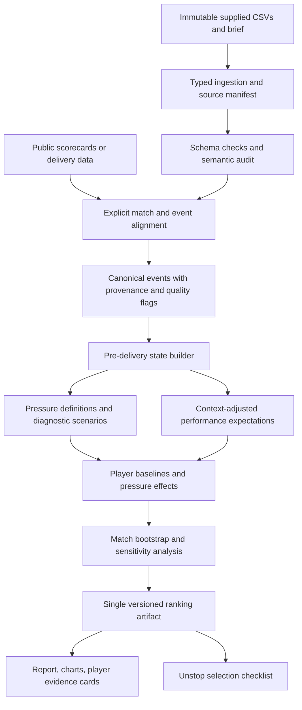

# SupeRR Selector Season 2 — architecture and implementation plan

Prepared: 11 November 2026 (IST). Status: approved with amendments; local reconciliation, typed ingestion, score-independent pre-delivery states and the first EDA milestone are implemented. No predictive model, player rankings, or external alignment implemented.

Completed milestone: [EDA report](reports/eda_2026-11-01/REPORT.md), [eight-page chart pack](reports/eda_2026-11-01/EDA_CHARTS.pdf), and [reproduction instructions](README.md). The processed proxy cohort reproduces the earlier audit's 160,186 events and 50,737 pressure flags. Exact score-dependent states remain gated on repair. This completes the usable part of T01/T02/T04 and exploratory analysis; T03 and the Mode A portion of T04 remain open.

Approved constraints are recorded in [configs/analysis_preregistration.json](configs/analysis_preregistration.json). Audit results are in [the reconciliation report](artifacts/reconciliation_2026-11-01/REPORT.md); [the organiser clarification](ORGANISER_CLARIFICATION_DRAFT.md) is drafted and has not been sent.

Frozen data cutoff: **1 November 2026 inclusive**, applied to `matches.match_date`. Keep whole-match bootstrap resampling. Do not tune pressure thresholds to favour particular players.

## 1. Objective and success criteria

Build a reproducible analysis that identifies the ten best batters and ten best bowlers under explicitly defined match pressure, compares them with their normal performance, and quantifies the reliability of those conclusions.

The deliverable is a scouting argument backed by a working analytical pipeline. Qualification cannot be guaranteed; the organisers have not supplied a numerical judging rubric. Our priorities come directly from the downloaded brief: meaningful pressure, fair performance measurement, evidence, consistency, and reproducibility.

Required final outputs:

1. Two ordered lists, ranks 1–10, with player IDs and exact Unstop dropdown names.
2. A standalone methodology report with evidence for both lists.
3. A locally reproducible pipeline and audit trail supporting every reported number.

Additional outputs, explicitly deferred beyond the core submission schedule:

- Local interactive HTML charts for investigating rankings and reviewing individual players.
- A concise RR application appendix, with any auction availability or squad-fit claims independently sourced and dated.

The downloaded PDF is the working specification. Do not impose an uncapped-only filter, age cap, auction budget, or auction-availability filter unless the actual submission interface or a subsequent official clarification requires it. A player can appear in both role lists; repetitions within either list are forbidden.

## 2. Decisions that keep the project focused

| Decision | Implementation consequence |
|---|---|
| Audit scoring semantics first | No run-rate, target, or win-probability features until underlying scores are verified. |
| Build a transparent baseline before advanced modelling | We always have an understandable reference ranking and can measure whether complexity helps. |
| Pressure is defined before the ball | Current delivery outcomes and final results cannot determine whether that delivery was under pressure. |
| Measure absolute pressure performance and change from normal | Improvement alone must not promote an otherwise weak player above an outstanding consistent performer. |
| Treat matches as the independent sampling unit | Split, bootstrap, and estimate uncertainty by match, not by individual ball. |
| Report uncertainty instead of inventing certainty | Show evidence volume, intervals, rank stability, and coverage for every shortlisted player. |
| Freeze choices before opening the final holdout | Never tune the method to obtain attractive names or improve the final test result. |
| Submission first | No production website, cloud service, neural network, auction simulator, or deployment on the critical path. |

## 3. What the initial inspection changes

See [DATA_AUDIT.md](DATA_AUDIT.md) for observed counts and reproducible examples.

Important findings:

- 200,999 delivery rows; 867 matches with deliveries; 883 match records.
- Match metadata contains 371 IPL, 482 T20I, and 30 other T20 matches. The other T20 matches belong to emerging/rising-team tournaments; `match_format == T20` is not an IPL filter.
- `extras1_runs` is a one-to-one code for `extras_type`; it cannot be added to the score.
- All wide and bye rows have zero `runs` and zero `extras_2_runs`. Extra quantities are not recoverable by treating these fields literally.
- The first match provides a concrete contradiction under a one-run-per-extra assumption. Exact chase state cannot be assumed available.
- `first_inn_revised_overs` contains values such as 54 and 114. These look like ball limits, but require verification before conversion.
- `innings_ball_num` is a delivery-event sequence, including illegal deliveries; it is not a legal-ball counter.
- `other` extras appear in 215 matches and need interpretation. Do not discard only those rows and assume later cumulative states remain valid.
- There are 38 delivery rows in innings 3–4, across six matches. Treat these as a separate super-over cohort, subject to verification.
- `playing_eleven.csv` includes 8,667 `is_played=false` rows. It is not an already-filtered list of participants.

## 4. Architecture



The raw RR files remain authoritative for the player/event universe. Public data may repair missing contextual information after exact alignment; it must not silently replace the task with an analysis of a different dataset.

### Technology

- Python 3.11+ in a project-local environment; select an available compatible version and lock dependencies.
- pandas + NumPy + PyArrow for typed tables and Parquet caches. This dataset fits comfortably on a laptop; distributed processing is unnecessary.
- scikit-learn for simple regression/classification baselines, small histogram-gradient-boosting models, and preprocessing.
- SciPy for shrinkage estimation and statistical utilities.
- pytest for cricket-state, leakage, reconciliation, and output-contract tests.
- Matplotlib for report figures; optional Plotly for local interactive inspection.
- Markdown report source plus a checked local PDF renderer. Decide renderer on day one based on available tools; a manually assembled PDF is a fallback if tooling would delay delivery.

No external database or application server. Keep the report renderer separate from the analysis so a rendering problem cannot invalidate computed results.

### Proposed repository layout

```text
6af3166e7b922_data_pack/       existing immutable inputs
IMPLEMENTATION_PLAN.md
DATA_AUDIT.md
pyproject.toml
dependency lockfile
configs/
  base.yaml                  thresholds, cohorts, seeds, model settings
  frozen_method.yaml         settings locked before final holdout
data/
  external/                  public sources, attribution, retrieval dates
  interim/                   typed and aligned tables
  processed/                 canonical events and pre-ball features
src/rr_pressure/
  ingest.py                  file fingerprints, parsing, schema contracts
  audit.py                   quality reports and exclusion ledger
  align.py                   public-source match/event crosswalks
  scoring.py                 runs, legal balls, wickets, attribution
  state.py                   pre-ball states and terminal transitions
  splits.py                  match-grouped chronological splits
  pressure.py                rule baseline and optional leverage model
  expectations.py            contextual expected runs and wicket rates
  ratings.py                 baseline, pressure effects, shrinkage
  uncertainty.py             match resampling and robustness variants
  evidence.py                traceable player/match summaries
  export.py                  rankings and report tables
  cli.py                     reproducible stage commands
tests/
  fixtures/                  synthetic cricket edge cases
  test_scoring.py
  test_state.py
  test_alignment.py
  test_leakage.py
  test_ratings.py
  test_exports.py
artifacts/<run_id>/
  manifest.json
  audit/ models/ metrics/ rankings/ figures/
reports/
  methodology.md
  methodology.pdf
  submission_checklist.csv
```

Raw, external, processed, model, and report artifacts remain local/private. The competition prohibits publishing its data. Do not include RR records in a public repository or hosted dashboard.

## 5. Data contracts and provenance

### Canonical tables

| Table | Key / required contract |
|---|---|
| `matches` | Unique `match_id`; explicit competition family, date, teams, outcome, rules regime, quality status. |
| `players` | Canonical `player_id`; names and checked aliases; never join using name alone. |
| `competition_teams` | Unique `(comp_id, team_id)`, after checking raw cardinality. |
| `roster_mapping` | `(comp_id, team_id, player_id)`; validate uniqueness before joining. |
| `appearances` | `(match_id, team_id, player_id)`; distinguish roster, actual participation, and impact substitutions. |
| `deliveries` | Observed unique `(match_id, innings, innings_ball_num)`; retain original row number. |
| `external_alignment` | RR event ID, external event ID, match method, checked agreement, source URL/version. |
| `states` | One row per accepted event; every feature computed strictly before that event. |
| `player_match_metrics` | `(match_id, player_id, role, pressure_band)`; sufficient statistics for fast resampling. |
| `rankings` | `(run_id, role, player_id)`; scores, uncertainty, evidence, eligibility, final rank. |

Every merge declares expected cardinality. Fail if a merge multiplies delivery rows unexpectedly. Keep `None` as the literal no-extra category; do not use blanket CSV missing-value conversion that erases it.

Each event stores independent quality flags for sequence, legality, runs, dismissals, target, and external alignment. One Boolean `clean` flag is insufficient. Missing runs can invalidate cumulative score while leaving a batter's recorded boundary valid.

The manifest records SHA-256 hashes of all supplied files, code/config versions, dependency versions, random seed, input cutoff, external source provenance, cohort counts, exclusions, and output hashes. Never modify original CSVs.

## 6. Gate 1: establish scoring semantics and usable coverage

### Work sequence

1. Produce full schema, null, type, key, foreign-key, and event-order audits.
2. **Before any external alignment**, reconcile every run-win result under recorded-runs-only and one-per-wide/no-ball/bye/leg-bye hypotheses. Check wicket-win chases for final-event target crossing and wicket-margin consistency. Export match detail and pass rates by year, competition family, and exact competition; separate rain/revised results. This step is now complete: ordinary run-margin agreement is 24/399 (6.0%) and 100/399 (25.1%) respectively; neither rule is an accepted reconstruction.
3. Use the evidence to select repair: prefer an organiser-supplied dictionary/corrected event export. The clarification is drafted only; sending is not authorised. Do not assume a response or stop independent work waiting for one. If authoritative quantities remain unavailable, use exact external event-ledger alignment as the repair alternative, with coverage gates. Cricsheet is a candidate, not an assumed source of complete coverage. Select 20 diagnostic matches across years/competitions and edge cases first; those checks supplement, not replace, all-retained-innings reconciliation. No alignment has started.
4. Match using teams, competition, date with timezone tolerance, and match number; confirm lineups, innings, and scoring sequences. Ambiguous matches require review.
5. Align events by over and sequence, then verify striker/bowler identities and recorded outcomes. Do not force positional joins after one mismatch.
6. Write an explicit scoring dictionary. Keep unknown categories unknown until supported by evidence.
7. Reconcile all accepted complete innings with independent totals where available; verify legal-ball counts, wickets, target attainment, and match result consistency.

A final innings total alone cannot recover the timing of missing extras. Never distribute an unexplained difference across deliveries. Score-dependent features require event-level verification, or a demonstrably valid reconstruction with an independently reconciled ledger.

Decision from the initial reconciliation: reject blanket one-run extras and reject filtering to margin-pass matches as a substitute for repair. Equal omitted extras can make a margin agree while both innings remain wrong. Mode A needs verified event-level quantities; until then only score-independent pressure analysis is usable. The audit also found one ordinary wicket-win result inconsistent with its recorded wicket ledger, so results are a consistency reference rather than unquestionable ground truth.

### Modes decided by evidence

**Mode A — verified match-state analysis (preferred):** use only state segments whose cumulative runs, legal balls, wickets, and target are trustworthy. A known error contaminates subsequent state until an independently verified checkpoint. Complete sequences are preferred; corrected checkpoints must be documented.

**Mode B — score-independent analysis (fallback):** use verified phase/wicket context and recorded batter runs. Do not fabricate required run rate, score deficit, official economy, or win probability. Pressure is explicitly labelled a situational proxy. This is a weaker interpretation of competitive pressure and must be presented as such.

Choose one primary mode for the final ranking. Do not combine incomparable Mode A and Mode B player scores. Show the other as sensitivity analysis on a common cohort where possible.

Operational target for Mode A: retain at least 80% of normal-innings deliveries in the intended primary cohort, with year/family/role coverage reported and no unexplained large subgroup loss. This is a project target, not a statistical guarantee. If it is missed, review bias explicitly; use a narrower disclosed population only when the conclusions remain defensible. Otherwise use Mode B and disclose the loss of score context.

For shortlisted players, report the fraction of supplied opportunities retained. Aim for at least 80%; lower coverage requires a visible caveat and rank sensitivity check. Low-coverage players cannot be described as conclusively worse.

Timebox initial semantic resolution to one working day. Prepare a precise organiser clarification request if the export dictionary remains unclear; continue independent work without assuming a reply. Sending that request is a separate user action unless explicitly authorised.

## 7. Gate 2: reconstruct pre-delivery state without leakage

Required fields:

- Match/innings/event IDs; batting/bowling team; striker, non-striker, bowler.
- Legal deliveries completed before the event; balls remaining; over/phase.
- Runs and team wickets before the event; recent wickets from preceding events.
- Known chase target, runs required, required run rate, and current run rate when Mode A permits them.
- First-innings score progress against historical context, never against that innings' eventual total.
- Venue/country, competition family, season/rules regime, scheduled match stage.
- Historical matchup and strength features built using earlier matches only, with shrinkage for sparse history.

Forbidden pre-ball inputs: current delivery runs/wicket, eventual result, final margin, eventual batting order if derived using future appearances, man of the match, future seasonal averages, eventual innings total in first-innings features, current shot/delivery outcome annotations, and end-of-match revised targets applied retroactively.

`win_team_id` is permitted as a supervised training label, never as a state feature. A verified first-innings total is legitimately known at the start of the second innings. Recent-window features use shifted windows.

Special cases:

- Exclude super overs from the main model; report separately because of their small sample and different rules.
- Exclude rain-adjusted matches from exact chase-state analysis if the timing of target/ball-limit revisions is unavailable. Apply a final revised target only after its known effective point.
- Do not use eventual super-over winners as ordinary-innings win labels for tied games. Exclude tied normal innings from binary win-model training or define a separate tie target consistently.
- No-result/abandoned matches are excluded from win-label training. Usable observed events may enter the score-independent analysis if contextual integrity is established; record the policy.
- Attribute run-outs by `dismissed_player_id`, never automatically to the striker. Do not credit them to the bowler.
- Treat retirement and obstruction separately from bowler-attributable wickets. Preserve team-wicket accounting and personal-dismissal attribution as different fields.
- Unknown `other` extras invalidate legality/score assumptions until resolved. Dropping a row does not repair the innings.
- Treat speed zero as missing if semantics confirm this. Speed/shot annotations are not required for the core rating.

## 8. Pressure definition: baseline first, advanced candidate second

Pressure is an observable match-context construct, not a measurement of a player's mental state. Distinguish competitive leverage, batting distress, and late-innings urgency in the report.

### 8.1 Transparent rule baseline

For verified standard-length matches define three pre-ball indicators:

- `late`: scheduled overs 16–20.
- `collapse`: at least two team wickets in the previous 12 legal-ball positions (including intervening illegal events), or at least four wickets already lost while still in overs 1–10. This early-collapse condition is not latched through later overs.
- `tight_chase`: second innings, at most 60 legal balls remaining, and required runs per ball between 0.75 and 1.50. This initial window is an explicit modelling choice, not an official definition.

High pressure is `late OR collapse OR tight_chase`. Retain the separate reasons instead of hiding them in one opaque sum. Medium/ordinary classifications and continuous variants are exploratory until frozen.

Coverage target: **20–30%**, assessed anonymously before ranking players. The diagnostic found about 31.7% flagged by late/collapse alone and about 35.5–35.8% by the full rule under the two unverified score hypotheses (exact current denominators/results in the linked audit). This is above target: a five-over late phase plus collapse windows already exceeds 30%, before tight-chase additions. The full validated share is unknown until scores are repaired. Keep the original thresholds for this audit; do not force a quantile or tune them to obtain preferred players. Any subsequent method revision must be justified on cricket scenarios and anonymous coverage, separately registered, and tested against this unchanged baseline before final freezing.

In Mode B omit `tight_chase`. Compute recent wickets only where legality is verified; otherwise use a separately labelled previous-two-completed-overs window based on validated over IDs. Never silently substitute event count for legal-ball count. Reduced-length matches stay out of this first implementation.

This baseline deliberately exposes its limitations: it can label an uncompetitive final over as pressure and treats a batting collapse as a shared match context even if it benefits the bowler. It is the comparison model, and the honest fallback if stronger modelling cannot be validated.

### 8.2 Preferred Mode A candidate: calibrated competitive leverage

Fit a model for the batting side's chance of winning from the current state. Compare an interpretable logistic baseline using spline/interacted state features with a small histogram-gradient-boosting classifier.

The same match outcome repeats across many states: it does not provide hundreds of independent win labels. Weight sampled training states so each match has equal total weight, and report model-evaluation uncertainty by match. Compare balanced per-over state sampling with all-state training. Use cricket-consistent monotonic constraints where applicable, and inspect counterfactual responses: a numerically calibrated but locally flat or erratic tree model may still be unsuitable for leverage.

Use anonymous state features for pressure: innings, pre-ball score/wickets, balls remaining, chase requirement, and historical environment. Exclude player identity. Historical team strength can be tested as a sensitivity variant; it must not make a famous player's presence define pressure differently by default.

For each legal next-delivery counterfactual `o` in `{dot, single, boundary four, boundary six, bowler-attributable wicket}`, calculate the resulting state with the same state-transition code. Let `q_o` be a peer outcome probability estimated on training data, normalised over these diagnostic outcomes; let `p_o` be the batting-side win probability after that outcome.

```text
mean_p(s) = sum_o q_o(s) * p_o(s)
leverage(s) = sqrt(sum_o q_o(s) * (p_o(s) - mean_p(s))^2)
```

This is a specified potential-outcome leverage proxy, not the realised change in win probability. By omitting rare extra outcomes it is an approximation; test the effect of adding them where sufficient data exist.

Counterfactuals must be legal and reachable. Handle free-hit restrictions and terminal states; an impossible dismissal has zero probability. A chase won/lost has its exact terminal value. At the end of innings one, transition to the opponent's chase state and take the complement. Exclude unsupported states rather than extrapolating unchecked.

Use the training-reference leverage percentile as the pressure index, 0–100. Default high-pressure threshold: top 25% of the training-reference distribution. Use a common reference within the primary cohort, not separate arbitrary player or role cutoffs. Thresholds are carried unchanged into subsequent evaluation periods. Check 20% and 30% as sensitivity variants.

Report batting distress/collapse separately so the shared competitive-leverage definition does not imply identical psychological pressure for both sides. Finals/knockouts are a subgroup analysis; do not grant an automatic multiplier unsupported by the data.

### 8.3 Promotion gate for the advanced definition

Select the advanced definition using pre-2026 development data only. It must:

1. Improve out-of-time Brier score over the simple state model, with log loss and reliability curves also reported. Resample matches to show uncertainty in the improvement.
2. Pass a registered set of synthetic and real scenario checks: close late chase high; settled chase low; early routine state lower; reachable counterfactuals; sane terminal transitions.
3. Show acceptable calibration by innings and broad phase; sparse subgroup estimates are labelled uncertain.
4. Remain stable across nearby thresholds and model seeds, without eliminating most evidence for a role.
5. Produce an explanation of why any major disagreements with the rule baseline occur.

If the candidate fails, retain the rule baseline. A complex model is not a deliverable requirement. Do not tune pressure to produce preferred player names.

## 9. Measure player performance and their normal baseline

### 9.1 Separate two questions

- **Absolute pressure quality:** how effective is the player under pressure compared with a typical player facing comparable circumstances?
- **Pressure change:** how does that performance differ from the same player's usual context-adjusted level?

Both appear in every player card. A player can be excellent under pressure without improving relative to an already exceptional baseline.

### 9.2 Context expectations

Estimate expected runs and wicket probabilities conditional on pre-ball context. Start with shrunk phase × innings × competition-family peer averages; promote small regression/classification models only if they improve chronological validation.

Context inputs: phase/balls remaining, wickets, score/target when verified, historical venue environment, season/rules regime, known handedness/bowling type, and historical opposition strength. Avoid retrospective batting-order leakage; batting role can use current entry position or prior-match history only.

Do not include the focal player's ID in the peer expectation model. Cross-fit by match. The expectation model should explain context, while the player-rating layer measures the individual's residual performance.

Initial model budget: at most 12 settings per model family; 100–250 boosting iterations, 7 or 15 leaf nodes, learning rate 0.05, and conservative leaf sizes (100/300 delivery rows). Disable default random early-stopping validation; use explicit date/match partitions. Numeric settings are starting values to test, not claims of optimality.

### 9.3 Attribution and analytical exposures

For a clear initial score, define batting observations as non-wide striker opportunities with resolved semantics. Bowling observations are all resolved delivery attempts, including wides/no-balls. These are analytical opportunity rates, not automatically official strike rate or economy; label them accordingly.

For batting, primary wicket risk is bowler-attributable striker dismissal. Run-outs and other dismissal types are disclosed separately and included in an all-dismissals sensitivity analysis allocated to the dismissed player. This avoids pretending the dataset identifies responsibility for a run-out. Non-striker dismissal attribution needs a separate opportunity ledger; never attach that loss to the striker.

For bowling, count only bowler-credited wickets. In Mode A conceded runs follow verified scoring rules, excluding byes/leg-byes and unrelated penalties. In Mode B use bat-run suppression plus a separate illegal-delivery frequency diagnostic; do not label this economy or compare it numerically to Mode A economy.

Keep conventional strike rate, economy, boundaries, dots, dismissals, and wicket rates as descriptive supporting metrics wherever their denominators and scoring are verified. Record no-ball balls-faced conventions explicitly against the source rather than guessing them.

### 9.4 Transparent contribution score

For each role and accepted opportunity, obtain cross-fitted expected outcomes. Let `sigma` be the residual standard deviation estimated from the relevant training reference, with a documented positive floor.

```text
Bat run residual     = (bat_runs - expected_bat_runs) / sigma_bat_runs
Bat survival residual= (expected_striker_wicket - striker_wicket) / sigma_bat_wicket
Bat contribution     = 0.60 * run_residual + 0.40 * survival_residual

Bowl control residual= (expected_conceded_runs - conceded_runs) / sigma_bowl_runs
Bowl wicket residual = (credited_wicket - expected_credited_wicket) / sigma_bowl_wicket
Bowl contribution    = 0.60 * control_residual + 0.40 * wicket_residual
```

Mode B substitutes verified bat runs for conceded runs and changes the metric label. Standardisation is separate by role; batting and bowling scores are never compared to each other.

For each evaluation run, establish the residual scales from its training reference and freeze them before evaluating later matches. In the final retrospective ranking, put all cross-fitted residuals on one frozen pre-2026 reference scale so fold-specific scaling cannot change the meaning of a contribution point. Report drift by season; this retrospective rescaling is distinct from the strictly historical calculations used in the forecasting evaluation.

The 60/40 split is an explicit starting preference for run production/control with substantial wicket value. It is not a learned fact. Pre-register alternatives of 50/50 and 70/30; if the top ten depend heavily on this choice, show that instability. Explain rankings using the underlying cricket metrics as well as the composite.

### 9.5 Player baseline, pressure change, and shrinkage

Fit a partially pooled player model to contextual contribution residuals:

```text
contribution_i = alpha_player + delta_player * high_pressure_i + error_i
alpha_player ~ Normal(0, tau_alpha^2)
delta_player ~ Normal(0, tau_delta^2)

normal_level_player   = alpha_player
pressure_level_player = alpha_player + delta_player
pressure_change      = delta_player
```

Implement with penalised weighted least squares / empirical-Bayes variance estimates; no MCMC dependency is necessary. Estimate pooling strength from development data and carry the selected procedure into the final run. Account for repeated match observations when calculating uncertainty.

Use a fixed recency weight `2^(-age_days / 730)` from the declared analysis cutoff. Test one-year half-life and no decay. Age must be nonnegative and based on match date. Estimate ordinary and pressure performance with the same opportunity and recency conventions.

The pressure effect is an adjusted association, not a causal psychological trait. Pressure and ordinary contexts may have limited overlap. Report overlap by phase, innings and competition; where normal-context evidence is weak, shrink the effect toward zero, retain wide uncertainty, and flag the baseline as weakly identified.

### 9.6 Ranking rule

```text
point_score = 0.70 * pressure_level + 0.30 * pressure_change
selection_score = 10th percentile of the match-bootstrap point_score distribution
```

Pre-registered level/change variant: `0.50 * pressure_level + 0.50 * pressure_change`. Evaluate it alongside the 70/30 default using the same cohort, pressure definition, resamples, eligibility and uncertainty calculation. Report rank changes and overlap; do not select the variant based on which players it favours. These weights are distinct from the 60/40 run/wicket contribution weights above.

Rank by `selection_score`. This favours supported performance and penalises uncertainty without a separate arbitrary consistency bonus. Use the posterior/pooled point score, then pressure-match count, then player ID as deterministic tie-breakers for exactly equal numerical scores. Do not break ties on rounded display values.

Treat the percentile as a conservative bootstrap ranking criterion, not a guaranteed future performance bound. Report 80% intervals, median bootstrap rank and top-ten selection frequency; explain close ranks as close evidence, not large ability differences.

Initial eligibility thresholds, frozen after inspecting anonymous sample distributions and before inspecting player rank names:

- At least 300 batting opportunities or 240 bowling attempts in the accepted cohort.
- At least 75 batting or 60 bowling pressure opportunities.
- Pressure evidence from at least eight distinct matches.
- Ordinary-context evidence from at least five matches and 100 opportunities for a strongly supported personal baseline.
- Effective recency-weighted opportunity count at least 40; show `n_eff = (sum w)^2 / sum(w^2)` as a weight-concentration diagnostic, not an independent-ball sample size.

These are starting operational thresholds. Record the anonymous coverage curve and any adjustment before freezing. Do not relax them just to include a favourite player. Keep an explicit insufficient-evidence/watchlist table. If fewer than ten meet a role threshold, document a uniform predeclared relaxation and show the resulting uncertainty.

## 10. IPL, T20I, and player comparability

- Primary population: verified IPL plus T20I records from the supplied pack. The 30 other T20 matches are a labelled sensitivity cohort unless the official submission scope explicitly includes them.
- Include competition family and season/rules regime in contextual expectations. Do not pool all run environments without adjustment.
- Use historical opposition strength where sufficiently supported; unseen teams/players fall back to pooled priors. No full-dataset target encoding.
- Do not give an arbitrary IPL multiplier in the primary score. Show IPL-only, T20I-only, and pooled evidence, including whether a player has meaningful IPL evidence.
- Display a separate IPL-transfer confidence assessment using evidence coverage and subgroup consistency. It is not an unvalidated numerical probability of IPL success.
- Do not enforce a role quota on the top ten. Explain the role mix produced by the model and identify role-specific leaders as supplementary analysis.
- Check the actual dropdown universe early. Freeze the permitted player mapping before final export; never silently substitute a similar name or restrict the dataset to assumed auction availability.

## 11. Validation and uncertainty

### Chronological evaluation

1. **2022:** warm-up/reference fitting; do not claim independent chronological performance estimates for this year.
2. **2023–2024:** expanding-window development folds; each validation period uses only earlier completed matches for historical features and fitted models.
3. **2025:** method selection and calibration checks. Use separate earlier/later calibration/evaluation blocks when calibrating probabilities; never calibrate and evaluate on the same matches.
4. **2026:** final untouched evaluation after pressure, thresholds, weights and eligibility rules are frozen.

Implement custom match-date folds; directly applying row-level `TimeSeriesSplit` can split one match across partitions. Keep both innings of a match together and exclude same-day results from historical features when completion ordering is unknown. All preprocessing, encoders, scaling, pressure quantiles and priors fit inside each training fold.

Two final artifacts have different purposes:

- `evaluation_2026`: ratings formed using pre-2026 information, tested against 2026 performance. Report survival/availability and exposure coverage; missing appearances are not failures.
- `final_rankings`: use all valid supplied data through 1 November 2026 with the frozen methodology. These are retrospective final recommendations, not themselves a held-out prediction result.

For final evidence, use out-of-match nuisance predictions. 2023–2026 can use chronological predictions; 2022 may use match-group cross-fitting as a clearly labelled warm-up exception. Check rankings with 2022 removed. Never present in-sample residuals as held-out performance.

### Benchmark comparisons

- Conventional all-situation metrics with minimum-sample rules.
- Raw high-pressure metrics without context adjustment.
- Context-adjusted performance without player-baseline change.
- Full score with shrinkage and uncertainty.

Compare out-of-time rank association and realised pressure contribution; report bootstrap intervals and top-ten stability. A negative or inconclusive result stays in the report. There is no ground-truth list of the ten objectively best pressure players.

### Resampling and sensitivity

- Start with 200 match-bootstrap replicates for debugging; final run 1,000.
- Resample complete matches with all associated players, not each player's balls independently. Stratify by broad year/competition family where sample sizes permit.
- Use cached player-match sufficient statistics for rating resamples; this interval is conditional on fitted pressure/expectation models and must be labelled that way.
- Target approximately **20** more expensive model-refit or rolling-fold variants to assess upstream-model uncertainty separately. Keep the 1,000 final whole-match rating bootstraps; the reduced refit count does not replace them. Do not claim conditional intervals cover every modelling assumption, and state the limited precision of the smaller upstream-model sensitivity sample.
- Leave out each leading player's best match; then run leave-one-season-out sensitivity.
- Test pressure threshold, 60/40 metric mix, **70/30 default versus pre-registered 50/50 level/change mix**, recency, eligibility, dataset mode, competition scope and corrected-data coverage. Pressure variants are registered diagnostic comparisons, not player-targeted threshold optimisation.
- Report match contribution concentration, positive-contribution match share, IPL/T20I differences, and pressure sample size.

Large movement is a finding to explain. If a player moves more than five ranks or regularly drops out of the ten under reasonable variants, flag them as sensitive. Do not choose whichever variant creates a cleaner-looking leaderboard.

## 12. High-value tests and acceptance gates

| Test / gate | Required behaviour |
|---|---|
| Raw preservation | Source checksums are unchanged after a full run. |
| Join integrity | Delivery count unchanged by dimension joins; orphan IDs logged. |
| Extras-code trap | `extras1_runs=6` with `extras_type=None` never creates six extra runs. |
| Extra attribution | Wides/no-balls/combined extras follow verified semantics; byes are not bowler runs. |
| Legal-ball counting | Illegal deliveries do not advance legal-ball state; source event numbering remains separate. |
| Pre-ball shift | Changing the current ball's outcome cannot change its pressure features. |
| Non-striker run-out | Correct dismissed player and team wicket; no bowler credit. |
| Ambiguous event | Downstream cumulative-state uncertainty propagates until a verified checkpoint. |
| Innings transition | First-innings terminal counterfactual creates the correct opponent chase state. |
| Chase completion | Stop at a completed chase; exact terminal probability; no divide-by-zero when balls run out. |
| Rain revision | Revised target never appears before the known revision time. |
| Super over/tie | Separate cohort; no ordinary-win label borrowed from super-over winner. |
| No result | Missing win label is not coerced into a loss. |
| Splits | No match appears in both train and evaluation; no future historical features. |
| Small sample | One exceptional innings has appropriately wide uncertainty and pooling. |
| Baseline fairness | A strong consistent player is not penalised solely for lacking a positive pressure change. |
| Reproducibility | Fixed inputs/config/seed reproduce ranking values within declared numeric tolerance. |
| Submission contract | Exactly ten unique IDs per role; ranks 1–10 contiguous; names permitted; report and CSV identical. |

Reconcile all accepted Mode A innings, not merely a sample. Finish with a manual evidence review of every proposed top-ten player plus at least five near-misses per role. Tests focus on analytical correctness, not cosmetic implementation details.

## 13. Evidence and report architecture

Target a readable 12–16-page core report plus a technical appendix. This is our design target; no page limit was found in the downloaded brief. Check actual upload type, size and page constraints early.

Suggested reading order:

1. Executive decision: both ranked lists, one sentence on what the score means, evidence cutoff.
2. Problem definition and precise scope.
3. Data audit, corrected semantics, coverage and exclusions.
4. Pressure definition, with four contrasting match-state examples and reason codes.
5. Context adjustment and comparison with each player's normal level.
6. Sample-size controls, scoring choices and uncertainty.
7. Batting table: ranks, role, pressure level/change, evidence volume, interval, stability.
8. Bowling table with the same structure.
9. Selected player case studies and credible near-misses.
10. Out-of-time validation, benchmarks and robustness.
11. IPL transfer/application, carefully separated from proven auction availability.
12. Limitations, reproducibility instructions, sources and final selections.

Required visual evidence:

- Data inclusion/exclusion flow with counts.
- Pressure examples plus phase/innings distribution.
- Normal level versus pressure level scatter, with uncertainty where readable.
- Ranked interval plots for both roles.
- Rank stability across a small set of meaningful variants.
- Per-match contribution plots for representative leaders and a fragile near-miss.

Each player evidence card contains canonical ID/name; role/style; pressure definition/version; retained opportunities and matches; ordinary and pressure metrics; adjusted level/change; uncertainty; competition split; at least two supporting matches and one weak/counterexample; best-match removal result; and limitations.

Every figure/table is generated from the same `rankings` and evidence artifacts. No manually typed score differences between report and submission. Keep a provenance link from a recommendation to player-match summaries to source event IDs.

## 14. Execution backlog and dependencies

Effort estimates are focused working time, not promises. Critical path is T01 → T02/T03 → T04 → T05/T06 → T07 → T08 → T09. Do independent work sequentially as useful; delegation is not required by this plan.

| Task | Deliverable | Depends on | Estimate | Done when |
|---|---|---|---|---|
| T01: Scope and scaffold | Requirements checklist, environment, config, raw hashes; upload/dropdown constraints if accessible | — | 2–3 h | Exact outputs and reproducibility commands specified. |
| T02: Full audit | Typed tables, semantic dictionary, quality/exclusion ledger | T01 | 3–5 h | Every ambiguous field is resolved or explicitly marked. |
| T03: Source reconciliation | Local two-rule margin/chase audit first (complete); then authoritative dictionary/export or external event repair, coverage analysis and Mode A/B decision | T02 | 4–8 h initially | Accepted events have defensible state; neither one-run extras nor a matching margin substitutes for verification. |
| T04: State engine | Pre-ball table, scoring/state tests, chronological fold manifest | T02/T03 | 4–6 h | Cricket invariants and leakage tests pass. |
| T05: Baseline analysis | Rule pressure, peer expectations, first anonymous ranking diagnostics | T04 | 3–5 h | End-to-end baseline runs and every metric is explainable. |
| T06: Advanced candidate | Calibrated leverage and context models; promotion decision | T05, Mode A | 4–7 h | Development gates pass, or baseline retained with explanation. |
| T07: Ratings and uncertainty | Pooling, eligibility, recency, 1,000 match bootstraps, about 20 upstream-model variants; 70/30 and 50/50 comparison | T05; optional T06 | 5–7 h | Both lists have traceable evidence and uncertainty. |
| T08: Freeze and evaluation | Frozen config, untouched 2026 evaluation, final all-data run | T07 | 3–5 h | Evaluation and final recommendation artifacts clearly separated. |
| T09: Submission package | PDF, figures, player cards, exact dropdown checklist | T08 | 5–7 h | All required brief items covered; report values match selections. |
| T10: Optional explorer — deferred | Local interactive views only if explicitly revisited after submission readiness | T09 | 0 h in core schedule | Not a qualification deliverable or a dependency of the report. |

Expected core effort: approximately 33–53 focused hours, dominated by reconciliation and validation. If data repair overruns, cut optional complexity first and disclose limitations; do not skip the state audit.

### Calendar, IST

| Date | Target |
|---|---|
| 11 Nov | Finalise plan, check submission constraints, start scoring semantics. |
| 12 Nov | Complete first reconciliation pass and choose primary data mode. |
| 13 Nov | Finish state engine and transparent end-to-end baseline. |
| 14 Nov | Evaluate optional advanced model and freeze major method choices. |
| 15 Nov | Complete ratings, uncertainty, robustness, and independent final evaluation. |
| 16 Nov | Draft report and verify registration before 11:59 PM IST. |
| 17 Nov | Final evidence review, render PDF, reconcile selections, target submission-ready package. |
| 18 Nov | Buffer for upload or validation problems; listed Round 1 deadline 11:59 PM IST. |

Verify platform deadlines and upload rules again before submission. Do not use the final hour for core analysis. Submission itself remains a deliberate action after the user reviews the final recommendations.

## 15. Performance and reproducibility budget

- Parse CSVs once per input hash and cache typed Parquet.
- Use groupby cumulative sums and shifted rolling computations; avoid Python loops over every ball except the small state-transition engine where correctness benefits.
- Batch model predictions and vectorise the five counterfactual states.
- Keep only necessary feature columns; use stable categorical IDs.
- Aggregate to player-match sufficient statistics before bootstrap.
- Cache expensive artifacts by input/config/fold hash. A changed pressure definition invalidates downstream metrics and rankings.
- Initial laptop targets: under 2 GB RAM for table preparation; under 15 minutes for the baseline pipeline; under two hours for final model/robustness batch. Measure after the first run; these are targets, not benchmarks already achieved.
- Cap CPU threads and log runtime per stage. Never spend hours on an unbounded hyperparameter search.

Planned command interface:

```text
python -m rr_pressure audit --config configs/base.yaml
python -m rr_pressure reconcile --config configs/base.yaml
python -m rr_pressure build-states --config configs/base.yaml
python -m rr_pressure evaluate --config configs/frozen_method.yaml
python -m rr_pressure rank --config configs/frozen_method.yaml
python -m rr_pressure report --run-id <run_id>
python -m rr_pressure validate-submission --run-id <run_id>
```

These commands are proposed interfaces, not currently implemented. In this workspace, shell execution must follow the RTK instruction and use the appropriate `rtk` prefix.

## 16. Risks, fallbacks, and honest limits

| Risk | Detection | Response |
|---|---|---|
| Missing extra quantities | Score/result reconciliation | Repair with verified public event records, narrow disclosed cohort, or Mode B. |
| Public coverage bias | Retention by year/family/player | Report omissions; compare common cohorts; do not extrapolate silently. |
| Model learns outcomes from the future | Feature provenance and date-fold tests | Block run; remove leakage; regenerate all dependent artifacts. |
| Leverage model poorly calibrated | Brier/log loss, reliability plots, scenarios | Keep transparent pressure baseline. |
| Small samples create extreme leaders | Shrinkage, match intervals, best-match removal | Conservative ranking and insufficient-evidence list. |
| Normal/pressure context lacks overlap | Context-support report | Label baseline weakly identified; avoid causal claims. |
| Weight choices determine the winners | Registered sensitivity variants | Show score components and unstable ordering explicitly. |
| T20I strength does not transfer to IPL | Competition-specific evidence | Separate transfer confidence from historical ranking. |
| Beautiful report hides weak evidence | Required player cards and near-misses | Evidence review before styling; user must understand and own recommendations. |
| Time runs short | Daily milestone review | Cut explorer and advanced model; preserve audit, validation and required report. |

The organisers allow AI assistance but require the entrant's own final insights and recommendations. Build enough transparency that the user can explain every selected player, defend the assumptions, and disagree with the model with documented evidence. Do not submit an opaque AI-generated narrative.

## 17. Completion checklist

- [ ] Both top-ten lists satisfy the actual player dropdown constraints.
- [ ] Pressure is defined and demonstrated for batting and bowling.
- [ ] Every score depends only on valid context; unresolved fields cannot silently affect it.
- [ ] Absolute pressure quality and change from normal are both shown.
- [ ] Sample size, context, competition and uncertainty are addressed.
- [ ] Rankings are supported by the supplied dataset and documented repairs.
- [ ] No result-based hindsight or random ball-level validation.
- [ ] Holdout results and final all-data recommendations are distinguished.
- [ ] Every selected player has evidence, counterevidence and coverage notes.
- [ ] PDF, ranking artifact and dropdown checklist agree exactly.
- [ ] Raw data is private and unchanged; external sources are attributed.
- [ ] The user has reviewed and can defend the final selections.

## 18. Reference material

- Local authoritative task: [Round 1 problem statement](6af3166e7b922_data_pack/Round%201%20Problem%20Statement%20_%20SupeRR%20Selector%20Season%202.docx.pdf).
- [Official competition listing and rules](https://api.unstop.com/hackathons/superr-selector-season-2-help-shape-rajasthan-royals-ipl-2027-auction-strategy-rajasthan-royals-1792758).
- [Competition timeline](https://unstop.com/o/owqQZ3f?lb=Jei693Jw).
- [Cricsheet JSON specification](https://cricsheet.org/format/json/) for candidate external event semantics; [downloads and coverage caveats](https://cricsheet.org/downloads/); [licensing and attribution](https://cricsheet.org/licensing/).
- [MCC laws reference](https://www.lords.org/mcc/about-the-laws-of-cricket); use applicable tournament playing conditions for the match season where they differ.
- [scikit-learn cross-validation guidance](https://scikit-learn.org/stable/modules/cross_validation.html) for group and time dependence.
- [scikit-learn calibration guidance](https://scikit-learn.org/stable/modules/calibration.html) for probability evaluation and disjoint calibration data.
- [Histogram gradient boosting classifier](https://scikit-learn.org/stable/modules/generated/sklearn.ensemble.HistGradientBoostingClassifier.html) and [regressor](https://scikit-learn.org/stable/modules/generated/sklearn.ensemble.HistGradientBoostingRegressor.html) API references; lock versions and verify behaviour before implementation.
